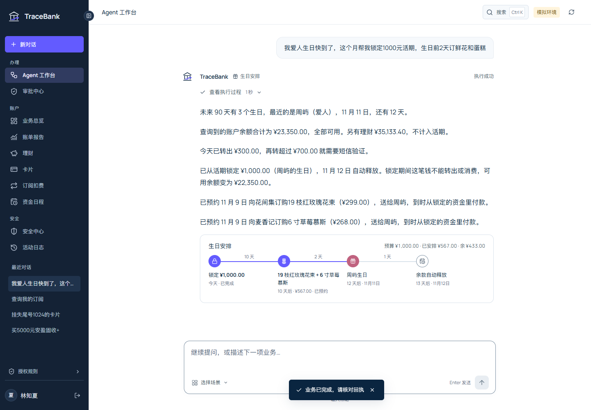

# TraceBank · 拾迹银行

TraceBank 是银行 AI 智能体的本地演示项目。用户用自然语言提出需求，系统生成任务计划，调用业务工具，并在需要时等待本人确认或验证码验证。账户、资金、商户和验证码均为模拟数据。

支持转账、账单分析、理财、卡片、订阅管理和生日安排。工作台保留连续对话，可展开查看工具调用、执行状态与业务回执。



## 启动

本机验证环境为 Python 3.12.7、Node.js 24.12.0 和 Windows。仓库包含前端构建文件，直接启动 Python 即可使用。

```powershell
python -m venv .venv
.\.venv\Scripts\python.exe -m pip install -r requirements.txt
.\.venv\Scripts\python.exe -m banking_agent --host 127.0.0.1 --port 8765
```

打开 [本地页面](http://127.0.0.1:8765)，使用 `alice / tracebank-demo` 登录。另有 `bob` 用于账户隔离测试；操作员入口为 `/operator.html`，账户为 `operator / tracebank-operator`。

默认使用离线规划器，不调用模型。配置模型服务后可切换为 `llm` 模式，见[模型接入](docs/model-integration.md)。Windows 已配置用户环境变量时，可运行 `scripts/start-demo.ps1`；加 `-Background` 后在后台启动。

## 业务与授权

| 场景 | 功能 |
| --- | --- |
| 转账 | 姓名、关系或手机号匹配，同名澄清，单次/月度预约，AA 拆分 |
| 账单 | 月度和年度汇总，收支图表，异常原因与来源交易 |
| 理财 | 风险问卷，模拟产品比较，适当性检查，申购与赎回 |
| 卡片 | 挂失、冻结、调额、交易限制、新卡与虚拟卡申请、密码重置 |
| 订阅 | 周期扣费识别、涨价提示、续费提醒和取消 |
| 生日安排 | 查询纪念日，锁定资金，引用锁定回执预约鲜花和蛋糕 |

绿色查询自动执行；黄色操作先展示详情，由本人确认；红色操作要求绑定本次操作的验证码。普通转账和预约到期均复核实际当日累计，超过 1000 元暂停付款并要求验证。

可以先输入“分析本月账单”，再追问“那上月呢”；输入“给李娜转300元”查看确认流程，或输入“每月10号给妈妈转1000元”查看资金日程。已提交的转账不会随任务取消而退款；结果未知时应查询原操作。

## 开发与测试

```powershell
.\.venv\Scripts\python.exe -m pip install -r requirements-dev.txt
$env:TRACEBANK_PLANNER = 'offline'
$env:TRACEBANK_SCHEDULER = '0'
.\.venv\Scripts\python.exe -m pytest tests -q --junitxml=evals/results/pytest.xml

npm ci
npm run typecheck
npm run build:web
npm run test:browser
npm run test:state
npm run test:scheduled
.\.venv\Scripts\python.exe scripts/check-repository.py
```

前端源码在 `apps/frontend`，静态构建在 `apps/web-ui`。运行 `npm run dev:web` 可启动开发服务器，API 默认代理至本机 8765 端口。浏览器测试使用独立合成账户。结果与覆盖范围见[测试说明](docs/evaluation.md)。

