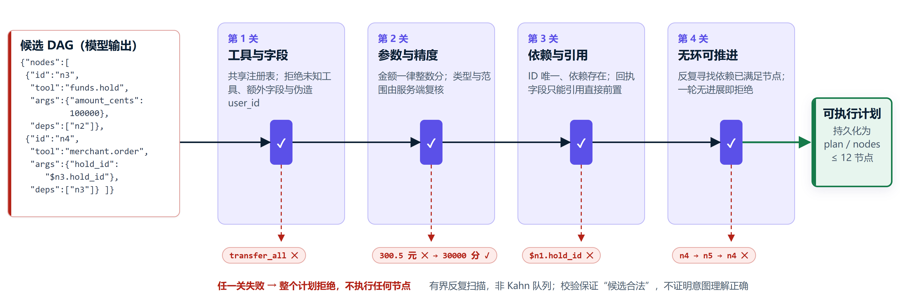

# 核心算法

## 意图与上下文

离线模式以规则匹配已覆盖表达；模型模式使用兼容Chat Completions接口生成候选计划。两种模式进入相同的工具校验与银行授权流程。同名联系人、缺少金额或条件不清时需要澄清。模型失败会显示错误，不自动改成离线成功。

会话保存有限的请求与候选摘要，支持省略期间、补充参数和连续追问。开放表达与新增六场景的完整模型覆盖仍需专项验收。

## DAG校验

校验由 `planner.validate_nodes` 和 `tools.check_params` 执行：

1. 拒绝未知工具、额外字段、非法类型及越界金额。
2. 限制12个节点，要求ID唯一且依赖存在。
3. `$node.hold_id`等回执引用只能指向直接依赖允许的字段。
4. 反复寻找依赖已满足的节点，无进展则拒绝计划。

当前采用有界反复扫描，未使用线性复杂度的拓扑队列。结构有效不保证模型一定理解了用户意图。



## 执行与恢复

执行器扫描pending节点：前置失败或取消则停止后继，前置全部成功才执行。读工具保存观测；写工具以`plan_id:node_id`为幂等键创建操作，保存operation ID，授权后继续同一计划。回执引用由服务端解析为实际编号。

恢复和重试复用原operation。停止不会撤回已提交转账；结果未知时先对账，不能新建第二笔扣款。

## 风险与预约

业务日按UTC+8划分，金额用整数分计算：

```text
实际当日已提交转账金额 + 本次金额 > 100000分 → 红色验证
否则 → 黄色确认
```

提交在`BEGIN IMMEDIATE`中复核累计，防止多个待确认操作共同越过阈值。预约到期也使用实际执行日累计；超限时先保存独立红色付款，不扣款。OTP校验后走普通转账提交路径，重算当前累计与余额。

预约执行记录通过`operation_id`关联付款。已关联的付款按普通转账回执统计，不在预约总额中重复求和。月度预约每期重新判定，创建时的验证不能替代到期验证。取消、过期及业务条件失败均不付款；unknown保留原操作用于核实。

## 幂等与事务

同一用户、同一幂等键与相同参数复用原操作；参数不同时拒绝冲突。单个银行事务同时写入收付余额、正负分录、交易、回执和审计。模拟通道在提交后丢失响应时返回unknown，对账只读取已提交结果。

## 业务计算

| 算法 | 当前实现 |
| --- | --- |
| 账单汇总 | 按所属用户和期间查询，汇总分类及收支，保留来源交易ID |
| 异常提示 | 修正z分数`0.6745 × (金额－中位数) / MAD`，配合金额门槛；同类历史不足5笔或MAD为0时跳过统计项 |
| 规则线索 | 境外、凌晨、首次商户和10分钟内重复扣款，逐条保留原因 |
| 周期扣费 | 近200天交易中识别相近周期与商户扣费，提示涨价和后续日期 |
| AA拆分 | 总额按整数分均分，余数归发起人 |
| 风险适当性 | 8题映射C1–C5，模拟产品为R1–R5；超等级拒绝申购，并检查测评期限和持有期 |
| 资金锁定 | 从可用余额扣除有效未用锁定，订单引用真实hold_id；储蓄目标只保存记录 |

异常输出是待核对线索，未训练欺诈分类模型。理财产品、净值和收益均为模拟。

## 事实回答与数值分析

`answers.py`把工具结果转换为事实段落。回答模型只选择已知内容标识，服务端映射回核验文字并增量显示。回答失败保留已完成查询，不重做业务。

数值DSL通过白名单AST解释表达式，不开放文件、网络或银行API。Windows使用独立worker和Job资源限制；详细范围见[安全设计](security-design.md)。
