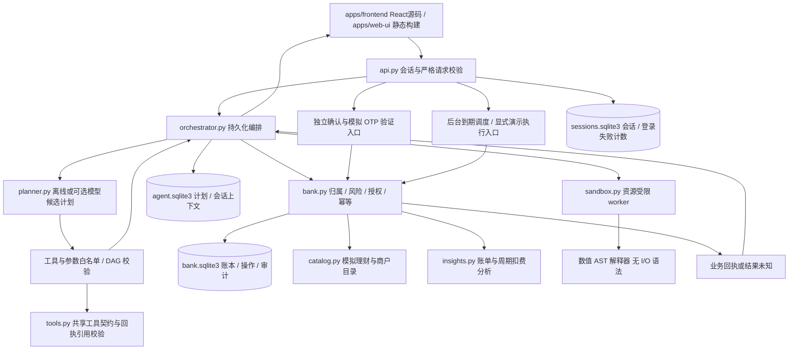
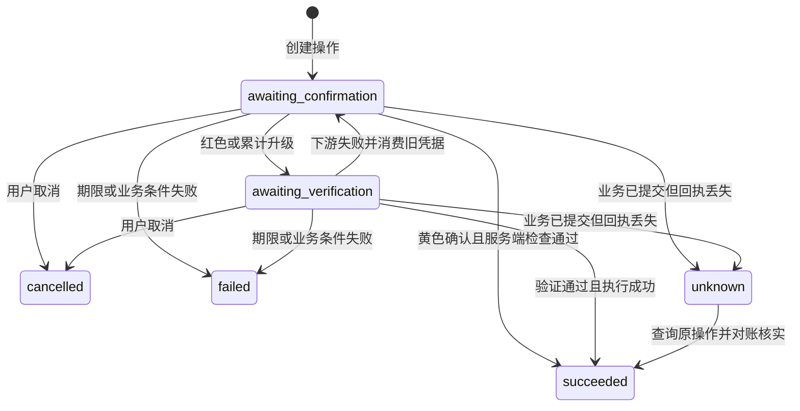

# TraceBank 实际系统架构

2026-10-27答辩补充：[系统架构SVG](../demo/technical-defense/assets/diagrams/architecture.svg)、[七张技术图及PPT对应表](../demo/technical-defense/coverage-map.md)。

材料更新：2026-10-26。对应功能基线 `18aa38d`。本文描述实际源码与模拟业务，不把历史真实模型测试视为新增六场景的完整模型验收。最新检查与已知缺口见[版本检查](review-20261026.md)。

## 1. 总体结构

当前采用 Python 服务加同源静态前端。逻辑上的 Agent、银行、认证和分析模块位于 `banking_agent/` 包中，并未强制拆成 `plan.md` 草案的多个 `services/*` 进程。这减少演示部署复杂度；授权仍由确定性银行服务处理。

图中反馈回路是系统交互；单个任务计划的依赖关系必须无环。模型不能直连账本，也不能调用演示 OTP 收件箱。

## 2. 源码职责

| 路径 | 当前职责 | 限制 |
| --- | --- | --- |
| `apps/frontend/src` → `apps/web-ui` | 10个业务视图、持久化连续对话、场景图表、授权/回执与审计 | React / TypeScript / Tailwind CSS；同源 API；旧 `apps/web` 仅为历史回退 |
| `apps/frontend/public/operator.html/operator.js` | 独立操作员登录、接管队列、填写说明后释放任务 | 构建时复制至 web-ui；只交还处理权，不代替客户确认或验证 |
| `banking_agent/__main__.py` | `python -m banking_agent` 启动，host/port/data-dir 参数 | 默认 127.0.0.1:8765，单 Uvicorn worker |
| `banking_agent/api.py` | 严格请求模型、会话、CSRF、同源、安全响应头及路由 | 演示身份，不具备真实银行认证体系 |
| `banking_agent/planner.py` | 离线基线、模型JSON提案、思考参数、严格Schema和DAG校验 | qwen3.8-flash固定15例已联调；开放表达和重复可靠性仍不能据此推出 |
| `banking_agent/tools.py` | 共享读写工具注册、参数类型、生成Schema与业务名称 | 模型提案与银行执行均复核；不接受自报身份与授权 |
| `banking_agent/answers.py` / `run_journal.py` | 已核验回答、分段事件与运行记录 | 不记录原始私密推理、密钥或验证码；银行回执决定是否成功 |
| `banking_agent/insights.py` / `catalog.py` | MAD异常提示、周期扣费识别、AA拆分、模拟产品与风险问卷 | 解释性模拟算法，不是欺诈认证、真实产品推荐或真实商户报价 |
| `banking_agent/orchestrator.py` | 持久化计划、依赖执行、操作关联、暂停/恢复/取消/接管 | 进程内锁，不能替代跨 worker 任务租约 |
| `banking_agent/bank.py` | 数据归属、风险升级、OTP 挑战、幂等、账本和审计 | 模拟银行；外部清算、真实发卡和真实代扣未接入 |
| `banking_agent/sandbox.py` | 最小环境 worker、墙钟限制、Windows Job/POSIX rlimit | 资源控制不等于 OS 文件/网络命名空间 |
| `banking_agent/sandbox_worker.py` | 白名单 AST 数值解释 | 不执行任意 Python、不提供 I/O 或银行能力 |

## 3. 数据与事务

`bank.sqlite3` 保存模拟用户、账户、联系人、卡片、消费记录、授权操作、账本分录、订阅、目标、风险测评、理财持仓、资金锁定、预约与执行记录、AA账单、安全计数和审计事件。金额为整数分。转账产生一条负分录和一条正分录，并在同一事务中更新收付余额与业务回执。资金锁定减少可用余额，订单到期付款引用锁定编号；它们均为本地模拟账本状态。

`agent.sqlite3` 保存计划 JSON 与会话上下文。计划节点持久化银行 operation ID，使用 `plan_id:node_id` 生成幂等键；重试或恢复应回到原操作，不能无条件生成新扣款。

`sessions.sqlite3` 保存随机会话 token 的摘要、CSRF token、期限和登录失败计数。客户端不能通过请求指定其他用户身份。

银行重要读写使用 SQLite 事务。当前三个数据库不是一个分布式原子事务，因此业务可能已经提交而计划状态尚未更新；恢复时须查询原 operation。相关崩溃窗口需依赖集成测试，不以“用了 SQLite”代替验证。[Python sqlite3 文档](https://docs.python.org/3/library/sqlite3.html)说明库的事务控制，具体业务语义以本项目为准。

## 4. 计划与执行

1. API 从服务端会话得到用户；请求模型拒绝额外身份/权限字段。
2. 规划器接收自然语言和有限上下文，输出工具、参数与依赖；同名或缺少关键参数时澄清。
3. `validate_nodes` 限制最多 12 个节点，检查工具、参数、金额、依赖、重复 ID 和环。
4. 编排器保存计划。绿色读节点直接查询所属用户数据；可执行写节点只创建操作，等待授权。
5. 用户在操作卡片确认；红色操作先生成独立验证挑战，由银行服务核验 OTP。
6. 普通银行操作在事务内复查归属与相应风险条件，生成回执。编排器依据真实操作状态推进后续节点。预约到期执行尚未重算实际当日累计的强验证升级，不能套用普通转账已验证的结论。
7. 每次计划创建、步骤启动/更新/失败、控制及银行授权/执行事件按关联 ID 进入审计。

离线规则基线对含“如果/除非”的条件任务主动澄清，不擅自完成条件授权；支持范围外的表达不会编造已执行结果。多任务 DAG 可以在依赖满足后推进，但不代表离线解析器能理解任意复杂语言。

## 5. 授权与状态

普通转账日累计按 UTC+8 当天已提交金额合计，≤100000分为黄色，超过为红色。挂失/解挂、解除冻结、提高额度、放开交易限制、重置交易密码和理财申购采用红色。2026-10-29补齐预约到期路径：在银行事务内重算实际日累计，超限生成本期独立红色操作，待本人验证后付款。该操作经持久化预约记录校验归属，不伪造Agent计划；审批响应的`plan`可为空。详见[修复记录](scheduled-transfer-fix-20261029.md)。

暂停/接管是计划状态，不能改变已提交账本。取消只取消未提交操作；unknown 必须先对账。操作员以独立角色读取 `GET /api/admin/handoffs`，通过 `POST /api/admin/plans/{id}/release` 提交用户 ID 与处理说明，记录 `operator.released` 审计事件。释放回到客户待处理状态，不代替客户确认/认证。普通客户不能访问 admin API，操作员不能访问客户业务 API；证据见 `tests/test_operator.py` 和 `evals/results/operator-browser.json`。

## 6. 账单和受限分析

分类汇总、总支出、收入及异常证据由确定性后端生成并关联 source transaction IDs。异常采用MAD修正z分数与境外、凌晨、首次商户、短时重复扣费规则；周期扣费根据近200天流水识别。它们是演示分析，不是欺诈认定或已训练的完整ML风控模型。

“用沙箱计算本月消费总额”映射到受限表达式。编排器取所属用户负向交易的绝对金额列表传给 worker，结果单位为 CNY cents；收入不会被混入消费总额。表达式是数值语言，不提供文件、网络或银行 API。

worker 使用独立 Python `-I -S`，最小环境、空临时目录、输入与 AST 限制。Windows Job 限内存、CPU 与进程数量，墙钟到期终止；设置失败即拒绝。它不等于通用 Python OS 沙箱，相关剩余边界见[安全设计](security-design.md)及 [Microsoft Job Objects](https://learn.microsoft.com/en-us/windows/win32/procthread/job-objects)。

## 7. 审计和可观测性

业务与编排事件包含关联 plan/node/operation/receipt ID，记录状态、策略判定和必要参数指纹。OTP、API key 和原始私密推理不进入审计。hash 链可发现现存记录的局部改写，但没有外部可信锚，不能声称不可篡改或完整合规归档。

结果从回执与存储状态产生，不由模型自由编写“已成功”。模型调用错误中止规划，不静默伪装成功。`/api/health` 暴露规划模式；`live_model_verified` 仅表示本进程已收到过通过校验的真实模型响应，重启重置，不代表全局安全或质量认证。

## 8. 尚未交付的边界

当前已有模拟资金锁定、到期调度、AA收款请求与演示收款、理财申购/赎回和商户预约。`goals.create`仍只是目标记录，`funds.hold`才改变模拟可用余额。没有真实银行、商户、短信认证、外部资金冲正或多worker编排保证。分支DAG表示依赖关系，不代表工具运行已实现多线程并行，也没有多轮自主重规划。后台调度仅在进程运行时处理，到期执行与原计划展示的同步、累计验证和崩溃恢复仍需专项验收。

本轮183项离线测试通过、30组页面/尺寸检查通过；新增六场景没有完整重做真实模型验收。当前架构图以本页与新版PPT为准，早期`figures/architecture.pdf`保留为历史图稿。
