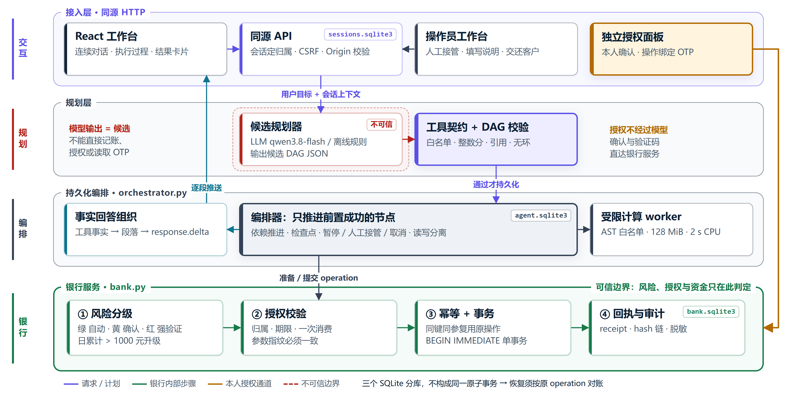

# 系统架构

TraceBank 由 FastAPI 提供业务接口和同源静态页面。React 工作台提交请求，规划器生成候选任务，编排器检查依赖，银行服务负责授权与记账。

[查看完整图](figures/architecture.html)。图源由 `scripts/render-figures.mjs` 维护，前端依赖安装后可重新生成。

## 模块

| 模块 | 职责 |
| --- | --- |
| `apps/frontend` | 对话、业务页面、审批、验证码面板与执行记录 |
| `api.py` | 会话、CSRF、同源检查及客户/操作员角色隔离 |
| `planner.py`、`tools.py` | 离线或模型规划，共享工具契约和DAG校验 |
| `orchestrator.py` | 保存计划、解析前置回执、推进节点及处理人工控制 |
| `bank.py` | 账户归属、风险分级、OTP、事务、预约和审计 |
| `answers.py`、`run_journal.py` | 事实回答、持久化事件与增量输出 |
| `insights.py`、`catalog.py` | 账单规则、模拟产品、风险问卷和业务计算 |
| `sandbox.py`、`sandbox_worker.py` | 独立进程中的受限数值计算 |

## 一次请求

1. API从会话确定用户，忽略聊天中自报的身份或权限。
2. 规划器输出工具、参数和依赖；缺少关键参数时先澄清。
3. 校验器检查工具白名单、严格参数、唯一ID、合法引用及无环依赖，最多12个节点。
4. 编排器保存计划，只推进前置成功的节点。查询读取所属账户，写操作等待授权。
5. 用户确认固定详情；红色操作在独立面板提交验证码。
6. 银行服务复核业务条件，在事务中记账并生成回执；编排器据此继续后续步骤。
7. 回答引用工具观测和回执，页面通过持久化事件展示进展。

分支DAG表达依赖关系，当前执行器采用顺序扫描。系统尚未实现多轮自主重规划或多worker任务租约。

## 数据存储

| 数据库 | 内容 |
| --- | --- |
| `bank.sqlite3` | 模拟账户、交易、操作、授权挑战、预约、锁定、理财、账本及审计 |
| `agent.sqlite3` | 计划JSON、会话上下文和运行事件 |
| `sessions.sqlite3` | 会话token摘要、CSRF、期限、角色和登录失败计数 |

金额使用整数分。银行事务同时更新余额、平衡分录和业务回执。计划库与银行库分别提交；崩溃恢复时必须核实原operation，相关跨库窗口尚未穷尽验证。

## 预约与人工控制

预约到期在银行事务内重算实际执行日累计，超过1000元时创建本期独立红色付款操作，暂停并显示在审批中心。每期操作与预约执行记录关联，普通付款回执和预约记录只计数一次。验证码通过后才付款；月度预约在本期成功后推进日期。

暂停、取消或接管会阻止后续未提交步骤，已经提交的资金变动保留。操作员通过独立角色填写说明并交还任务，仍由客户完成确认或验证。结果未知时只核实原操作。

## 结果与审计

工具结果先形成确定性事实与段落；回答模型按用户问题选择已知段落标识，服务端输出对应文字。模型不能自由改写金额或生成成功回执。

审计使用plan、node、operation和receipt关联执行过程，并清洗验证码、密钥、PIN与私密推理。hash链没有外部可信锚，仍需补充签名、备份及访问控制。详细控制与风险见[安全设计](security-design.md)和[安全自评](security-self-assessment.md)。
