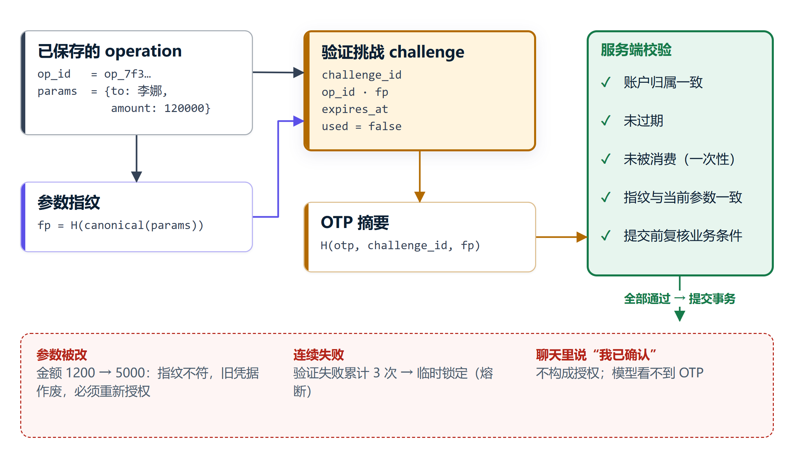

# 安全设计

保护对象包括模拟账户余额、业务参数、授权挑战、会话、计划和审计。模型输出、用户消息及工具文本都需要经过服务端检查。

## 授权边界

| 级别 | 执行条件 | 示例 |
| --- | --- | --- |
| 绿色 | 校验用户归属后自动读取 | 余额、交易和账单 |
| 黄色 | 固定操作详情，本人明确确认 | 日累计不超过1000元的转账、锁定、AA、取消订阅 |
| 红色 | 本次操作的独立验证码验证 | 超限转账、挂失/解挂、放开交易限制、密码重置、理财申购 |

风险由银行服务计算。聊天中的“我已确认”不构成授权。操作绑定用户和参数指纹，参数改变后需重新发起授权。

OTP摘要结合challenge和参数指纹计算，校验期限及单次消费。连续3次失败触发5分钟锁定；旧凭据在验证成功后即消费，即使下游通道失败也需要新挑战。同应用可读的演示收件箱尚不具备独立多因子认证条件。

## 预约与重复执行

普通转账和预约到期均在银行事务内重算实际日累计。超过1000元的预约先保存独立红色付款，验证前不扣款；月度预约每期重新判断。执行记录唯一关联本期付款，重启和重复调度复用原操作。

同键同参数复用业务操作，不同参数拒绝。银行事务同时更新余额、平衡分录和回执。提交后响应丢失进入unknown，核实原操作后再更新状态；已提交或未知操作不能直接取消。

## 输入与注入

API从会话确定身份，严格请求模型拒绝额外字段。工具白名单与参数契约独立于模型提示词，候选DAG须通过节点、引用和无环检查。

绕过表达与可疑备注的关键词规则只提供辅助拦截。10分钟内3次可疑尝试、1分钟内超过8次操作会触发写入限制；未知注入及恶意工具返回仍需开放集测试。

## 会话和人工控制

Cookie使用HttpOnly与SameSite，写请求检查CSRF和Origin。客户和操作员角色分别校验。暂停、取消或接管的计划不能通过直接授权端点继续自动执行；操作员交还任务后仍由客户授权。

## 结果与审计

金额、状态和成功结论取自工具观测与业务回执。模型只能选择已知回答段落，不能生成新的金融金额或成功回执。

审计关联计划、节点、操作、授权及回执，并清洗OTP、密钥、PIN和模型私密推理。hash链可以发现现存记录的局部改写，无法充分发现删尾或整体重算，尚需外部锚点和独立保全机制。

## 受限计算

数值DSL只解释允许的AST和聚合函数，不使用eval/exec，没有文件、网络或银行API语法。worker使用独立Python进程和最小环境。Windows Job限制128MiB、2秒CPU和单进程，另有墙钟限制；资源限制设置失败即拒绝执行。

该能力只覆盖数值语言。开放任意Python前，需要重新设计文件、网络及系统权限隔离；POSIX分支尚需目标平台验证。

## 故障与部署

连续通道失败会熔断，结果未知只查询原操作。当前仅支持单worker，跨库崩溃恢复仍需专项测试。演示口令、故障注入和同应用OTP不适合真实银行或公网生产部署。控制证据和已知风险见[安全自评](security-self-assessment.md)。
