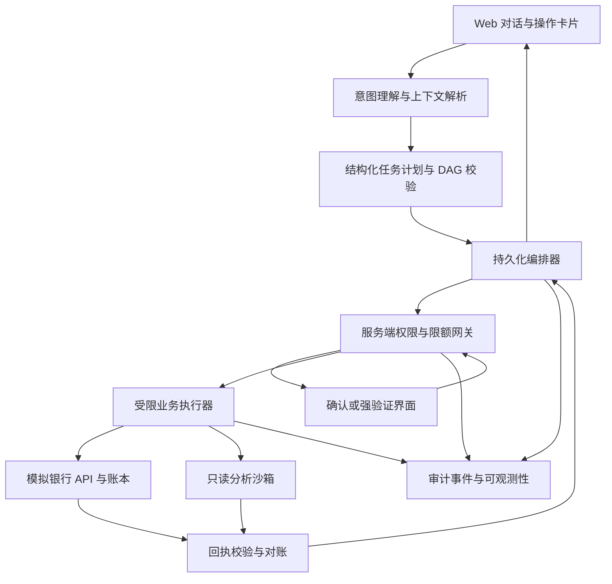

# 银行 AI 智能体比赛完成计划

日期：2026-10-20；执行更新：2026-10-21。需求依据：[problem.md](problem.md)；技能清单依据：[SKILLS-REVIEW.md](SKILLS-REVIEW.md)。

## 1. 最终要完成什么

完成一个可部署、可演示、可测试的银行 AI 智能体，以及有文献依据的方案报告、架构配图、技术文档、安全自评、答辩材料和演示视频。

暂定产品定位：**一句话办业务，每一步有凭据。** 用户用自然语言提出需求，系统理解上下文、生成任务计划，在服务端权限规则约束下调用模拟银行业务接口，并展示可核对的执行结果。

用户选择文献“快速回顾”，初次先交离线演示；后续已提供工作空间并选择qwen3.8-flash思考模式，真实模型固定集联调完成。本地Git提交由用户后续自行publish。实际入口见[提交清单](docs/submission.md)，限制见[安全自评](docs/security-self-assessment.md)。下文保留完整路线，尚未实现的预约、AA、冻结、冲正、理财与生产认证不列入已完成能力；2026-10-22已新增Agent工作流版PPT、讲稿与真实模型实录，原离线版本保留存档。

### 完成优先级

| 优先级 | 范围 | 完成判据 |
| --- | --- | --- |
| P0：必须完成 | 智能转账、账单分析、卡片管理；三级权限；审计；熔断；隔离执行；任务规划与人工接管 | 三个业务场景端到端可运行，所有 P0 安全用例通过，按赛题提交资料齐全 |
| P1：增强吸引力 | 订阅管理、跨场景联动、可视化任务与回执、多轮模糊意图理解 | 在 P0 稳定后完成，演示可复现，失败路径有明确处理 |
| P2：有余力再做 | 理财适当性与模拟申购赎回、语音、更多渠道、可选 KYC | 单独验收，不占用 P0 的安全与交付时间 |

不以场景数量作为唯一目标。若时间紧，保留三个完整场景和安全证据；停止增加未完成的扩展入口。

## 2. 先调研什么，调研要支持哪些决定

调研核心问题：**如何让银行 Agent 在减少操作步骤的同时，可靠执行复杂任务、约束金融风险，并让用户理解和控制执行过程？**

以下是待检索主题与关键词，不代表已经验证的文献结论。

| 调研主题 | 待回答问题 | 检索关键词示例 | 要落到项目中的决定 |
| --- | --- | --- | --- |
| 银行助手与用户需求 | 用户最常见的操作障碍是什么？Revolut AIR 的实际公开能力与边界是什么？ | banking conversational agent、financial assistant、Revolut AIR official | 产品定位、核心场景、交互基线；区分厂商宣传与实测证据 |
| 工具调用与任务规划 | 自由规划、固定工作流、混合方式各有哪些失败条件？ | LLM tool use、ReAct、Plan-and-Execute、task graph | 意图结构、工具 schema、规划器与执行器分离方式 |
| 状态持久化与人机协作 | 怎样暂停、恢复、取消、接管？确认应在何时出现？ | durable execution、human-in-the-loop、interrupt resume、mixed initiative | DAG 节点状态、检查点、确认交互和恢复语义 |
| 权限与授权 | 怎样防止模型自行授予权限、确认被挪用和累计限额绕过？ | least privilege、capability security、transaction authorization、step-up authentication | 独立权限网关、参数绑定、过期与防重放、并发限额控制 |
| 注入与工具安全 | 外部文档、交易备注、工具返回能否诱导越权？ | indirect prompt injection、tool output injection、agent security benchmark | 数据与指令隔离、工具白名单、工具执行端强制检查、对抗集 |
| 金融执行可靠性 | 超时后如何判断是否扣款？如何防止重复执行？ | payment idempotency、double-entry ledger、transaction reconciliation、outbox、saga | 账本、幂等、结果未知状态、查询与对账、补偿边界 |
| 账单与异常分析 | 分类如何可解释？冷启动下如何识别异常而不过度断言？ | transaction categorization、recurring payment detection、financial anomaly detection | 分类 taxonomy、异常证据、规则与统计基线、反馈纠错 |
| 可信交互与评估 | 展示哪些信息有助于用户决策？怎样同时测量成功率和安全性？ | calibrated trust、explainable financial AI、agent benchmark、tau-bench | 任务轨迹、操作卡片、成功率、误拦截率与攻击测试方案 |
| 隔离和可监控执行 | 生成代码在哪运行？资源和数据访问如何限制？ | code execution sandbox、container isolation、read-only filesystem、resource limits | 分析沙箱与资金执行服务隔离、审计和资源限制 |
| 可选理财与身份资料 | 风险画像、产品约束、资料缺失怎样进入确定性规则？ | investment suitability、KYC extraction、rules engine | P2 的风险问卷、模拟产品目录与证据化核验 |

### 检索与证据记录方法

1. 优先查找论文原文、正式会议或期刊页面、作者公开代码和产品官方文档；用官方资料核实产品及框架当前能力。中文法规只在确有业务需求时检索主管机关原文，不照搬国外技能中的阈值。
2. 重点覆盖近年 Agent、安全与评测研究，补充必要的经典规划、事务和人机协作工作。执行时记录检索日期、检索式和时间范围，不预先编造命中数。
3. 按“是否影响本项目的一项设计决定”挑选文献；保留失败结果、反例和不支持所选架构的研究，避免只找支持性材料。不设置凑数式参考文献指标。
4. 每项材料记录标题、作者、年份、正式发表或预印本状态、DOI/官方 URL、实际阅读范围、关键段落或章节、方法、局限及适用场景。摘要阅读不得写成全文阅读。
5. 维护“主张—来源—原文位置—适用边界—工程决定”证据矩阵。论文存在和论文支持该主张分别核验。
6. 普通检索先使用浏览和权威页面，按 ARS 的 Codex 适配规则执行；确需批量 DOI、BibTeX 或论文获取时再使用 `opencite`，不自动调用收费服务或上传项目私有材料。
7. 输出标明这是实际采用的调研形式；未执行完整预注册、筛选和报告流程时，不宣称完成系统性综述或 PRISMA 研究。

## 3. 已安装的 skill 怎么分工

以下技能已核对本地 `SKILL.md` 存在。按具体任务加载，避免一次性套用全部技能。

### 调研、写作和材料交付

| 技能 | 计划用途 | 预期产物或约束 |
| --- | --- | --- |
| `academic-research-suite` | 主导文献检索设计、来源核验、主题综合、报告撰写和证据检查 | `report.md`、检索记录、证据矩阵；按选定工作流分阶段执行 |
| `opencite` | 需要时获取论文元数据、DOI、BibTeX 和可公开获取的全文 | 引用记录、可选 `references.bib`；遵守 ARS 的默认网络路径与获取边界 |
| `scientific-brainstorming` | 有证据后形成多个差异化方案，比较用户价值、实现成本与验证难度 | 方案取舍表；候选创新点标记为设计假设，不包装为已证实创新 |
| `lieflat-less-ai-tone` | 报告与答辩文字定稿后清理规则清单命中的 AI 表达 | 仅修命中项，不改变文章框架、证据或技术含义 |
| `presentations:Presentations` | 制作并检查答辩 PPT | 可编辑演示文稿及预览；讲稿总时长不超过 10 分钟 |
| `documents:documents`、`pdf:pdf` | 有需要时导出正式技术文档及安全自评 PDF/DOCX | 渲染后逐页检查；Markdown 为早期主版本 |
| `spreadsheets:Spreadsheets` | 有需要时整理测试结果、指标或预算表 | 可选测评工作簿，不作为必需依赖 |

### 银行业务和工程设计

| 技能 | 计划用途 | 对应阶段与限制 |
| --- | --- | --- |
| `banking-expert` | 账户、联系人、交易、卡片、金额精度的领域模型 | P0 领域设计；示例代码需重新实现事务与并发控制 |
| `workflow-automation` | 权限流程、人工确认、接管、状态机、审计 | P0 编排；审批示例不能覆盖赛题权限规则 |
| `integration-patterns` | 幂等、超时、重试、熔断、事件和补偿设计 | P0 执行服务；必须用测试验证重复请求和部分失败 |
| `operational-risk` | 风险清单、失败处置、事件升级、安全自评 | P0 安全与最终材料 |
| `personal-budgeting` | 分类、收支汇总、预算与月报设计 | P0 账单；浮点示例不能进入资金账本 |
| `ai-anomaly-detection` | 规则与统计异常基线、特征和解释 | P0 账单；先做可核对基线，再决定是否需要机器学习 |
| `statistics-fundamentals` | 汇总统计、波动及评测不确定性分析 | P0/P1 分析；明确样本量和适用前提 |
| `investment-suitability` | 风险问卷、产品适配、流动性约束 | P2 理财；美国规则只作概念参考 |
| `return-calculations`、`time-value-of-money` | 模拟收益比较、年化口径、复利和现金流计算 | P2 理财；不生成保收益承诺 |
| `kyc-doc-parse`、`kyc-rules` | 可选资料结构化、缺项和规则证据核验 | P2；不替代身份认证或生成不存在的筛查结果 |

### 画图

| 技能或方法 | 何时使用 | 产物和检查 |
| --- | --- | --- |
| Mermaid | 调研和设计初稿中的架构、状态与时序草图 | 嵌入 Markdown，方便随接口变化修改 |
| `thesis-figure-skill` | 定稿系统架构图、技术路线图和答辩用 draw.io 图 | 可编辑 `.drawio` 或 `.tex`，导出 SVG/PDF/PNG，检查布局和语义 |
| `tikz-scientific-figures` | 需要统一排版的矢量结构图或正式实验图时 | `.tex`、数据源、矢量 PDF/SVG 与预览；先检查工具链，再编译与视觉验收 |

结构图优先保证权限边界和执行路径清晰；不使用生成式插画替代技术架构。性能图必须来自实际测评，原型占位数据必须显著标记。

## 4. 怎样做得有吸引力

差异化假设：用户关心的不只是“能听懂”，还包括“办到了什么、为什么需要我确认、出错怎么办”。后续用竞品核查和任务测试检验这个假设。

### 主演示：从账单发现到安全处理

用户说：“看看这个月为什么花多了，把可疑消费查清楚，再帮我给小王转 300 元。”

系统展示可展开的任务卡：查询账单 → 分类统计 → 展示异常证据 → 等用户选择后续措施；解析转账联系人 → 展示收款人与金额 → 按日累计金额确认或验证 → 返回交易回执。

如果用户随后说“这张卡可能丢了，先挂失”，系统通过强验证再执行，并显示卡状态变化。识别到异常消费本身不能直接挂失或认定欺诈。

### 三个看得见的亮点

1. **可控制的任务计划。** 用户能看到待执行步骤，暂停或取消未执行节点；修改金额或收款人后重新授权。
2. **可核对的业务回执。** 每次成功展示业务 ID、状态、金额/对象及时间；“处理中”和“结果未知”有各自的后续动作。
3. **可复现的安全演示。** 展示日累计额度升级、重复请求仅执行一次、恶意备注无法绕过权限，以及故障后的查询与对账。

P1 可增加“月底预算助手”：分析订阅 → 提出可取消项目 → 用户选择并确认 → 创建储蓄目标。跨场景联动以可兑现的模拟接口演示，不承诺尚未接入的鲜花、蛋糕等外部服务已完成下单。

## 5. Agent 系统怎么完成

先实现一个主编排器、若干受限工具与确定性控制模块。是否增加多个模型 Agent，由失败分析和对比结果决定，不预设多 Agent 一定更好。



这是系统交互草图，存在恢复与确认回路；单个任务计划的依赖图仍必须是无环 DAG，重试和暂停属于节点状态管理。

| 模块 | 输入与输出 | 必须实现的边界 |
| --- | --- | --- |
| 意图理解 | 自然语言、有限会话上下文 → 类型化意图和槽位 | 缺收款人、金额或存在同名联系人时澄清；不能猜测关键参数 |
| 规划器 | 已解析意图 → 工具节点、依赖、前置条件 | 校验节点类型、参数、依赖、规模上限及是否有环；模型不能赋予执行权限 |
| 编排器 | 合法计划 → 节点执行、暂停、恢复和任务终态 | 持久化检查点；中断后不重复已完成资金操作；支持取消与人工接管 |
| 权限网关 | 用户身份、工具、参数、已消费与预留额度 → 放行/确认/强验证/拒绝 | 决策在服务端执行；每次写操作和恢复执行时复查，不接受模型自报已获授权 |
| 业务执行器 | 已授权且参数绑定的命令 → 业务回执 | 工具白名单、参数校验、幂等键；不得直接运行模型生成的任意代码 |
| 银行模拟器 | 账户、交易、卡片及后续扩展 API | 账本守恒、整数分或 Decimal、事务、余额和限额并发保护；测试数据可重置 |
| 分析服务与沙箱 | 脱敏且范围受限的数据 → 统计结果 | 资金写权限不可达；若执行生成代码，必须有独立隔离进程/容器和资源、网络、文件限制 |
| 回执与事实校验 | 可信工具响应 → 面向用户的结果说明 | 成功只能来自有效业务回执；缺数据、超时和矛盾回执明确标记 |
| 审计与观测 | 计划版本、策略结论、授权事件、工具调用、回执 | 使用关联 ID；记录必要的决策摘要及依据，脱敏，不记录原始私密推理、密钥或验证码 |

技术栈在调研和环境检查后锁定。初始候选：Python API 服务、关系数据库、类型化工具定义、Web 前端和持久化工作流。对比轻量自建状态机与现成图编排框架后再决定；锁定版本与可复现部署方法。

## 6. 赛题要求逐项落地

| 赛题条目 | 实施任务 | 验收证据 |
| --- | --- | --- |
| 智能转账 | 按姓名/手机号解析联系人，小额确认、大额验证、交易查询；定时和 AA 收款为扩展 | 接口测试、前端录屏、账本记录和回执一致 |
| 账单分析 | 分类统计、月份/年份筛选、异常证据、报告与数据溯源 | 与确定性汇总结果对比，异常样例逐条可核对 |
| 卡片管理 | 查询、挂失与解挂；写操作按赛题强验证 | 正常及错误/过期验证的状态转换测试 |
| 绿色自动执行 | 余额、交易记录、账单分析等允许的查询不重复确认 | 验证执行成功且没有写入副作用；账户所有权仍校验 |
| 黄色用户确认 | 日累计不超过 1000 元的小额转账、虚拟卡申请等执行前展示详情并明确确认 | 未确认不执行，参数变更使原确认失效 |
| 红色强验证 | 日累计超过 1000 元、密码修改、卡片挂失/解挂、理财申购等要求验证 | 当前登录身份加独立验证挑战；回调不经模型自行判断。模拟验证标明演示性质，不宣称真实短信/人脸服务 |
| 防幻觉 | 账户事实和交易结果绑定可信工具输出 | 接口失败、无数据和假回执测试均不报告虚假成功 |
| 防注入 | 隔离外部文档、备注、工具返回中的指令；执行端权限检查 | 用户指令、交易备注、资料文档、工具输出四类攻击样例 |
| 完整审计 | 跨规划、授权、执行、对账记录结构化事件 | 从会话定位到节点、命令、授权、业务回执；检测遗漏与篡改 |
| 异常熔断 | 通道故障熔断，加用户/会话可疑行为锁定 | 失败阈值、冷却、锁定和恢复策略测试；不能靠换会话绕过用户锁定 |
| 隔离运行 | 生成分析代码在受限且可监控的环境执行 | 超时、内存上限、禁网、越权读文件、写文件和访问资金接口的隔离测试 |
| 模糊与隐含意图 | 同名联系人、省略主语、上一笔引用、计划修改 | 固定对话集和人工核对的预期动作 |
| DAG、中断与回退 | 检查点、节点取消、恢复、接管、必要的补偿 | 进程重启和部分成功后恢复；失败补偿转人工处理 |

赛题将“订阅查询/取消”列在黄色范围，与“纯查询绿色”的概括存在表述交叉。实现时对列明的订阅操作暂按黄色处理并写入需求解释，不自行降低等级。身份资料提取也不能替代红色认证。

日累计阈值按人民币原值实现：已有700元，当次300元累计1000元为黄色，当次301元累计1001元为红色。以 `Asia/Shanghai` 定义演示业务日，在原子提交事务中重算已消费累计，防止并发和拆单绕过；当前没有额度预留、预约或资金冻结系统。未来新增定时执行时须另行验证到期授权和预留/释放。

## 7. 分阶段任务、依赖和交付

时间仅为规划估算，按约 15 个有效工作日安排；实际取决于团队人数、环境、模型接口与调研结果。安全测试和材料整理贯穿开发，不放到最后集中补做。

| 阶段 | 参考时间 | 任务 | 交付文件/功能 | 进入下一阶段的条件 |
| --- | --- | --- | --- | --- |
| A：需求与调研准备 | D1 | 建立需求编号、场景清单、检索问题、证据表模板、现有环境清单 | `docs/requirements.md`、`research/search-plan.md` | P0/P1/P2 清楚，所有强制项有对应任务 |
| B：文献与竞品调研 | D2–D3 | 检索、去重、阅读核验，按任务综合证据，列出架构方案与反例 | `research/search-log.md`、`research/evidence-matrix.md`、`report.md` 初稿 | 关键设计有可定位来源或明确标为假设，证据缺口可见 |
| C：规格与图稿 | D4 | 定义 API、数据模型、DAG/schema、权限矩阵、授权状态和威胁模型 | `docs/architecture.md`、`docs/security-design.md`、`docs/api-contracts.md`、架构草图 | 接口和授权边界可编码，P0 测试清单齐全 |
| D：可信后端 | D5–D7 | 实现模拟账本、转账、卡片、权限网关、确认/验证服务、幂等和审计 | 银行模拟器及服务端核心；单元和接口测试 | 并发、重复请求、限额边界、未授权调用测试通过 |
| E：Agent 与界面 | D8–D10 | 接入模型，意图和工具调用、持久化编排、账单分析、操作卡片 | 三个 P0 场景端到端运行 | 正常、歧义、拒绝、失败、中断和恢复路径可复现 |
| F：安全与吸引力打磨 | D11–D12 | 完成隔离执行、注入与故障测试、测评基线；余力完成 P1 | `evals/results/`、安全结果、订阅或联动扩展 | 无未解决 P0 安全阻断；扩展不破坏原有能力 |
| G：材料与交付 | D13–D15 | 定稿报告、配图、文档、PPT、录屏和部署；干净环境复现 | README、技术包、安全自评、答辩包、视频 | 按第 12 节清单验收，数据与描述一致 |

依赖主线：A → B → C → D → E → F → G。前端低保真、图稿草图和测试用例可在接口规格稳定后并行准备；最终实验图等结果数据产生后再画。

若仅剩约一周：收缩为转账、账单、卡片三个场景；减少视觉装饰和模型角色，沿用同一套权限与审计后端。不能删除赛题要求的安全机制来换取扩展功能。

## 8. report.md 怎么写

报告应回答“为什么这样做、证据支持到哪里、如何实现和验证”，而不是只罗列论文或技能。正文使用中文，保留英文术语、论文题名和可定位链接。

计划目录：

1. 执行摘要：产品定位、三个核心场景、推荐路线和关键风险。
2. 赛题解析：必须项、扩展项、表述歧义和可验收解释。
3. 检索方法与局限：范围、来源类型、实际阅读覆盖、排除理由和证据缺口。
4. 文献主题综合：规划与工具、授权与安全、可靠执行、人机交互、评测；比较结论与反例。
5. 竞品核查：已公开能力、证据来源、对本题可借鉴的交互，避免无证据的优越性宣称。
6. 产品方案取舍：多个候选的价值、成本、安全与演示难度，给出推荐方案和理由。
7. 系统与算法设计：意图、DAG、状态、权限、账本、异常检测、沙箱和审计。
8. 安全威胁模型与失败路径：攻击面、控制点、已知剩余风险。
9. 评价设计与结果：开发前写实验计划，开发后补入实际结果；清楚区分目标与实测。
10. 实施路线、演示脚本、提交材料与引用列表。

写作时分别标注：**来源结论、工程推断、设计建议、实测结果**。报告初稿不虚构实验数据、用户访谈、用户满意度或“首次提出”的研究贡献。没有用户研究时，产品吸引力只作待验证假设。

## 9. 具体画哪些图

| 编号与拟定文件 | 内容 | 用途 | 验收重点 |
| --- | --- | --- | --- |
| F1 `figures/architecture.*` | 前端、模型、编排、权限、认证、执行、银行模拟器、沙箱与审计边界 | 报告、技术文档、答辩 | 每条资金写路径必须经过权限网关；模型不能直连账本 |
| F2 `figures/authorization-flow.*` | 绿色、黄色、红色决策，累计额度与参数变更 | 权限说明、安全自评 | 精确包含 1000 元边界、拒绝、过期和重新验证 |
| F3 `figures/transfer-sequence.*` | 用户—Agent—权限服务—认证—账本—回执 | 解释安全转账与防重放 | 明确认证在模型之外；幂等、超时和结果未知处理完整 |
| F4 `figures/task-dag.*` | 多任务依赖、可并行查询、确认关卡、取消和接管标记 | 展示复杂任务规划 | 任务依赖无环，不能把重试循环误画为 DAG |
| F5 `figures/demo-storyboard.*` | 账单发现 → 用户选择 → 卡片挂失或转账 → 回执 | 产品方案、PPT和录屏 | 页面文字与真实能力一致，区分建议与已执行 |
| F6 `figures/evaluation.*` | 成功率、越权执行次数、重复执行次数、交互负担、时延 | 论证效果 | 标注样本数、测试条件与单位；只使用测评文件生成 |

先用 Mermaid 锁定语义，定稿时按目标版式转换为 draw.io 或 TikZ。每图保留一种明确的可编辑主源与导出件，避免多个版本相互覆盖。导出后检查中文字体、连线、重叠、字号、投影可读性和文件可编辑性。

## 10. 测试怎么证明“符合要求”

### 关键用例

- 正常流程：绿色查询自动执行；黄色确认后转账；红色验证后挂失；查询与账单总额一致。
- 权限边界：1000/1001 元；两笔并发小额转账；跨日；预约执行；确认后改收款人或金额；跨账户访问。
- 认证边界：错误、过期、重复使用和绑定对象不符；未验证不产生资金或卡状态变化。
- 工具与规划：同名联系人、缺槽位、用户纠正、循环 DAG、未知工具、错误参数、超大任务计划。
- 注入：在用户提示、备注、文档与工具返回中植入“忽略规则”“已确认”等指令，检查实际副作用。
- 故障：超时但后端已完成、重试、重复消息、进程重启、数据源不可用、部分成功与补偿失败。
- 分析：分类可纠正、异常有证据、冷启动或样本不足时降级；未知交易不随意归类为欺诈。
- 隔离：生成代码的死循环、大内存、外网访问、越权读写和调用资金服务被隔离机制阻止并留下日志。

### 指标与基线

| 指标 | 统计方法 | 目标或解释 |
| --- | --- | --- |
| 任务完成率 | 按预先定义的最终业务状态计算，不能由模型自己宣称成功 | 报告场景分项与总体结果；初始工程目标可设为固定正常任务集 ≥90%，待规模确定后冻结 |
| 越权执行次数 | 检查数据库和业务状态，统计未满足权限前置条件却成功的写操作 | P0 固定攻击集观察值必须为 0；不推广为对所有未知攻击安全 |
| 重复资金执行次数 | 同一业务命令重复请求、超时重发与重启恢复后检查账本 | P0 故障与并发用例必须为 0 |
| 误拦截和必要交互 | 统计合法任务拒绝率、澄清次数、确认次数与验证次数 | 同时检查便利性，不能以降低强制权限门槛换指标 |
| 回执与审计完整性 | 对照实际副作用逐笔检查业务 ID、授权、执行和结果事件 | 固定 P0 测试集全部可追溯；区分防篡改检测与真正不可篡改存储 |
| 时延 | 分别记录模型、工具、编排和端到端 p50/p95 | 排除或单列人工等待，报告模型版本、部署环境和重试条件 |
| 体验步骤 | 与明确的菜单式/表单式模拟基线完成同一任务对比 | 报告实际计数，不套用比赛背景中的平均值作为实测 |

本轮实际对比：同一离线规则规划器、工具、数据和任务集，完整编排与只执行首节点的受限对照。差异展示多步骤缺失，不能视为同模型Agent优劣或SOTA比较。真实模型对比按用户要求延期；没有多Agent增益证据，运行时不增加复杂角色。原始结果及G02事后协议修订保留。

## 11. 工作分工和文件组织

默认由当前主 Agent 顺序推进；有明确收益时再分派可独立验证的子任务。下表是工作包责任划分，不代表已经启动多个 Agent，也不代表多模型独立审查。

| 工作包 | 输入 | 输出 | 边界 |
| --- | --- | --- | --- |
| 调研与来源核验 | 赛题、检索计划 | 检索日志、注释文献、证据表 | 不把候选论文当成已读或已验证 |
| 综合与产品方案 | 经核验的证据、需求 | 报告和取舍理由 | 区分证据与推断，保留反例 |
| 后端与安全 | API、权限规格 | 模拟银行、网关、认证、审计、沙箱 | 模型没有银行服务的绕过权限 |
| Agent 与前端 | 稳定工具契约 | 规划、恢复、操作卡片与用户交互 | 不依靠前端或提示词独自保证安全 |
| 测评与复核 | 固定任务集、威胁模型 | 可复现测试和结果 | 核对真实副作用，保留失败记录 |
| 画图与交付 | 已稳定架构、真实测评结果 | 图稿、技术材料、PPT与录屏 | 不提前绘制虚构实验结果 |

建议目录，随最终技术栈调整：

```text
plan.md                         # 本计划
problem.md                      # 原始比赛要求
report.md                       # 文献调研与方案报告
research/                       # 检索日志、来源、证据矩阵
docs/                           # 需求、架构、安全、API、部署、已知风险
figures/                        # 可编辑图源和导出图
apps/web/                       # 对话、操作卡片和任务轨迹
services/agent/                 # 意图、规划和持久化编排
services/banking/               # 模拟银行、账本和业务接口
services/sandbox/               # 受限分析执行环境
tests/                          # 单元、接口、集成与安全用例
evals/                          # 任务集、攻击集、配置和真实结果
demo/                           # 数据重置、脚本、PPT、讲稿和视频
README.md                       # 安装、运行、限制和复现入口
```

## 12. 最终验收与提交清单

- [x] 快速回顾报告完成，11项来源有阅读范围与定位，设计假设分开。
- [x] 三个P0场景离线端到端可用，有后端状态与实录证据。
- [x] 三级权限、累计额度、并发、参数绑定及模拟挑战测试通过；真实认证未接入。
- [x] DAG、暂停/恢复/取消、角色隔离与接管已验证；资金冲正未实现。
- [x] 固定集防幻觉/注入、关联审计、熔断及数值DSL有证据；未知攻击和任意代码OS隔离未验。
- [x] 启动、新目录播种明确；固定依赖在不继承系统包的新环境安装并通过123项测试。
- [x] 技术文档含F1–F6图源/导出、核心算法和安全设计。
- [x] 安全自评含实现、覆盖、风险与模拟/真实差距。
- [x] 简介正文≤200字，明确规则规划及模型接口现状。
- [x] 10页可编辑PPT与讲稿，建议9分29秒含视频，仍需真人排练。
- [x] 113.683秒真实浏览器视频，包含业务成功、升级和对账。
- [x] 本地源码、README、部署与测试准备；按用户授权做本地Git提交，发布由用户处理。
- [x] 保留来源与第三方声明，不擅自选择项目开放许可；排除运行数据库、密钥，录像验证输入遮蔽。
- [x] 用户后续选择qwen3.8-flash思考模式，已完成真实API及固定15例联调、133项回归和7组模型浏览器验收；不代表开放攻击全面验证。
- [x] 2026-10-22新增Agent工作台、增量行动记录、模型用量凭据与规划中停止；140项项目测试、本轮6组真实模型工作流浏览器验证通过。
- [x] 新增10页Agent工作流版PPT、配套讲稿与约103秒真实模型实录；原离线材料保留。
- [ ] 真人排练与报名系统格式核对。
- [ ] GitHub URL与远端发布：用户后续自行publish。

### 5 分钟演示编排草案

| 时段 | 展示内容 |
| --- | --- |
| 0:00–0:35 | 用户痛点与一句话需求，展示三个场景和任务卡 |
| 0:35–1:25 | 绿色账单分析、分类统计与异常证据 |
| 1:25–2:15 | 联系人澄清、小额转账确认、真实回执 |
| 2:15–3:10 | 日累计越过 1000 元后的强验证，或卡片挂失的强验证 |
| 3:10–4:15 | 恶意备注、重复请求或超时场景，展示拦截和恢复证据 |
| 4:15–4:50 | 跨步骤追溯到审计与账本，说明已完成范围和剩余限制 |

余留约 10 秒用于转场。最终按稳定实现选择演示顺序，不为了视频观感隐藏失败状态。

## 13. 执行进度

- [x] 阅读比赛要求。
- [x] 完成金融技能选型，安装并验证 12 个技能。
- [x] 写成覆盖调研、写作、画图、开发、测评和交付的本计划。
- [x] 执行A：需求追踪和检索计划。
- [x] 执行B：快速回顾、检索日志、来源/证据表、报告与ARS形态/缩写检查。
- [x] 执行C–E离线范围：可信后端、编排、客户前端和操作员工作台。
- [x] 执行F–G离线范围：测试与评测、6张正式图、PPT/讲稿、简介、安全自评与实录。

离线基线：25/25固定用例、22/22业务目标、10/10安全探针；受限对照业务18/22，早期及干净环境123项通过。后续模型接入：qwen3.8-flash思考模式固定15/15、最终133项回归、7组模型浏览器验收通过，首次13/15记录保留。未做真人试验，不宣称效率或模型优越性。2026-10-22已完成Agent工作流界面与新版PPT/视频，140项项目测试及本轮6组浏览器工作流验证通过；后续扩展开放表达、多次可靠性与生产部署验证。


### 回答与可展开工具链修复

- [x] 独立回答区直接回应用户问题；省钱问题引用账单给出建议，剔除转账用途未知的部分，不承诺无依据的节省额。
- [x] 纯查询分析可另调用模型选择有依据的建议，金额和办理状态由服务端引用；失败时明确降级，不改变业务结果。
- [x] 执行过程默认折叠，可展开规划、输入、观测、授权和两阶段用量。
- [x] 不同场景使用实际工具和权限，授权及对账后更新回答；历史任务可从保存结果恢复答案。
- [x] 152项项目测试、本轮5组真实模型浏览器及原历史任务兼容检查通过。

### 金融工作台 UI 优化（2026-10-22）

- [x] 使用 frontend-design，先记录产品用户、设计系统、信息架构和交互规则。
- [x] React / TypeScript / Tailwind CSS 五模块，保留原有业务与服务端授权。
- [x] 账户指标、真实模拟流水图表与表格、审批和审计采用统一中性色与墨绿强调色。
- [x] 实际运行 Edge，保存首轮与改进截图；调整文字、图表、导航、生成时序和手机布局。
- [x] 153项后端回归、新 UI 独立离线实机交互，以及4组响应夹具时序检查通过。证据与边界见 docs/frontend-design-system.md。
- [x] 自托管字体与依赖许可随静态构建分发；旧PPT和视频保留历史界面，本次不冒称已重录。

### Premium Banking UI/UX 全面升级（2026-10-22）

- [x] 按完整附件，使用 ui-ux-pro-max 审查五路由、登录、操作员、授权与安全弹窗；记录技能检索和取舍。
- [x] 建立共享语义 token、字体/间距/圆角/控件/状态与 Motion 标准。参考 PayFlow，按用户最新要求取消绿色，改为冷灰与白、深海军蓝、少量实心靛紫。
- [x] 侧栏折叠、最近任务 Tooltip、Ctrl/Cmd+K、键盘场景、自动高度输入、真实请求 Skeleton、只读恢复与可关闭通知。
- [x] 实际执行进度、完整工具链/最终回答、可折叠宽度面板和真实 DAG 图；缩放/复位/键盘/拖动均有实际作用。人工确认、独立 OTP、未知结果对账保持原样。
- [x] 启动实际 Vite/Edge，五页面四视口截图后多轮修正布局、手机状态列、强调文字对比和配色，最终 37 张截图。
- [x] TypeScript/build、153 项后端回归、15 组离线业务浏览器、13 组交互、4 组时序、2 组异常与2组只读兼容检查通过；保留首次配置错误记录。
- [x] 更新已构建静态页、README、设计规则和交付记录；具体证据与剩余范围见 docs/premium-ui-qa.md。旧 PPT/视频未重录，远端仍由用户自行发布。

### Motion 动效（2026-10-22）

- [x] 使用 motion-design，引入 Motion 14.5.0，统一主页面淡入淡出、按钮弹簧与执行时间线状态动效。
- [x] 动效跟随真实业务状态，退出页/工具链 inert，原金融确认与最终回答时序保留；支持运行中改变减少动态效果偏好。
- [x] 实际开发和生产浏览器中间帧采样、截图及录屏；两轮各8组动效、15组离线业务及4组生成时序检查通过，见 docs/motion-ui-qa.md。

### 内容与信息架构重构（2026-10-22，当前版本）

- [x] 在独立分支 `codex/task-workspace-clarity` 先做内容审计、中文文案规则和两种明显不同的结构方案。
- [x] 应用已安装 Impeccable、Frontend Design、UI UX Pro Max；未安装技能和启动器检测限制如实记录。
- [x] 任务正文优先业务结果和授权；步骤、完整证据、模型/工具原始记录分三级按需展开；单节点不占整块图。
- [x] 依据后端实现八主要状态、未知/暂停/接管等额外状态；来源账户可核对，部分提交后取消保留真实交易，不自动重发。
- [x] 五模块及独立操作员内容精简；深导航、统一tokens、真实图操作、手机布局和原Motion交互保留。
- [x] 九状态1600×900前后截图与视觉迭代；5页×4视口、图故障与键盘验证通过。
- [x] 153项后端、16组真实离线业务浏览器、11组状态、7组布局/图/故障、4组时序、8组动效、2组已有模型任务只读兼容通过。
- [x] 已构建静态页面与当前 DESIGN.md、README、验收报告同步；详见 docs/clarity-ui-qa.md。远端发布、真人排练和旧PPT重录仍保留原边界。

### 动效可读性与逐段回答（2026-10-22，当前更新）

- [x] 使用motion-design复现并修复导航hover白底浅字；正文切换保持可读，按钮弹簧及真实时间线减小幅度。
- [x] 原生折叠、场景菜单、执行详情与弹窗增加过渡；执行详情移至回答前内联展开。
- [x] 后端SSE只将完整且存在的证据ID映射为核验段落，持久化增量事件；前端追加内容，最后替换正式回答，保留原金融权限。
- [x] 158项后端、17项最终回答复核、16组业务浏览器、8组动效、7组新交互和4组回答时序检查通过。
- [x] 独立合成账户真实qwen3.8-flash只读联调：约4.6秒首批输出、18.6秒完成，规划/整理两次请求共2206tokens，无金融写入。详见docs/motion-readability-qa.md。
