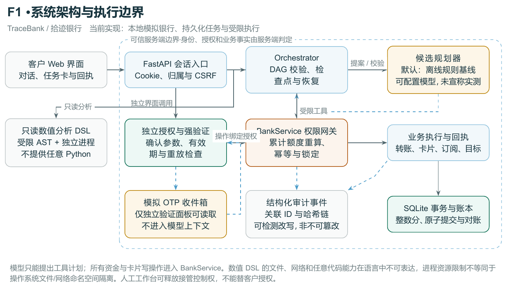

# TraceBank：面向银行业务的可验证执行 Agent

> 模型接入更新（2026-10-21）：本文主体保留离线交付基线的研究与测评口径。此后已完成用户选择的qwen3.8-flash思考模式联调，15例固定集通过、133项回归通过；最新范围与限制见[模型联调记录](docs/model-integration.md)。本文原有离线数字不能当作真实模型结果。

**文献快速回顾、产品取舍与离线原型报告**

版本日期：2026-10-21；检索截止日期：2026-10-21。需求依据：[比赛要求](problem.md)。

## 摘要

建议以“**一句话办业务，每一步有凭据**”作为作品定位：自然语言生成可见任务计划，后端独立判断权限，用户核对操作后确认或验证，系统展示与账本一致的回执。快速回顾选取 11 项论文、产品及工程一手材料，围绕规划、授权、提示注入、恢复和评价进行主题综合。证据支持把工具提案与执行权限分开，并结合业务终态、授权过程和攻击副作用评价系统；这些原则不构成本原型的普遍安全证明。已实现转账、账单、卡片三个核心场景及部分扩展，离线固定集通过 25/25，业务目标完成 22/22，另有 123 项自动化测试通过。当前语言理解采用规则基线，所有资金与验证码均为模拟；真实模型效果、真实多因子认证和生产部署尚待验证。

关键词：银行智能体；工具调用；任务编排；交易授权；提示注入；业务回执；离线评测。

## 1. 作品应怎样吸引评委

最有展示价值的对象是**从需求到业务事实的一条可检查路径**。用户提出“分析本月账单，然后给李娜转 300 元”，界面同时呈现任务步骤、账单依据、收款人与金额、需要的授权和最后回执；若之后挂失卡片，系统应明确升级验证。异常、歧义和超时也进入这条路径，评委能直接观察系统何时继续、何时等待，以及依据什么认定完成。

这一产品假设来自赛题的业务执行、安全与可接管要求，并未经过真实用户研究。比赛背景给出的“转账平均需要 3 步以上”属于题面背景，本项目没有独立采样验证，也不能将其当作已测得的节省步骤基线。

作品名称建议保留 **TraceBank · 拾迹银行**。“拾迹”对应三个可见内容：任务轨迹、授权依据和业务凭据。答辩避免堆叠模型角色，优先展示同一条业务链中的四个转折：同名联系人不能猜、累计额度会升级、聊天确认不能替代授权、扣款后丢失回执必须查询原操作。它们都能用固定数据复现，比增加尚未接通的服务入口更容易核对。

## 2. 快速回顾的方法与证据边界

研究问题为：**如何让银行 Agent 可靠完成多步骤业务，约束金融风险，并让用户理解和控制执行过程？** 用户选择“快速回顾”；ARS 没有单独的快速回顾模式，因此沿用文献检索、来源核验和主题综合流程，明确记录缩减步骤。本报告是工程决策导向的快速回顾，未声称完成系统性综述或元分析。

检索优先面向原始论文、正式论文官方页面、产品帮助和工程官方文档。实际查询覆盖 ReAct、τ-bench、AgentDojo、InjecAgent、CaMeL、Revolut AIR、交易授权与资源隔离，补入防御基准局限作为反向材料。近年 Agent 研究主要取 2022 年至检索日，2019 年人机交互论文作为设计参考。来源按“能否改变一项工程决定”挑选，未设置凑数目标。共选入 7 项论文或论文官方摘要材料、1 项产品帮助和 3 项安全/工程文档。全部查询、未纳入材料与实际阅读范围见[检索日志](research/search-log.md)、[来源记录](research/sources.json)和[证据矩阵](research/evidence-matrix.md)。

主要简化包括：定向网络检索，未穷尽多个文献数据库；没有独立双人筛选、预注册、完整全文覆盖或统计合并；没有检索平台完整导出，故不报告总命中量及流程图筛选数量。英文工具型 Agent 与安全研究占比较高，中国银行真实用户、交易分类大样本和生产认证证据不足。检索与写作采用协作人工智能（AI）工作流，共享上游证据材料，不构成独立复核。摘要阅读仅支持摘要范围主张；工程文档说明机制，不证明本项目正确。

## 3. 文献给出的设计依据

### 3.1 自适应规划需要执行边界

ReAct 将推理与外部行动交织，使后续处理能使用工具观察更新判断。这为“先查事实、再提出下一步”提供方法依据，不能直接证明资金执行安全。其任务环境与银行交易不同，工具动作是否被允许仍需单独决定。[Yao 等（2022）](https://arxiv.org/html/2210.03629v3)<!--ref:yao2022react--><!--anchor:section:Abstract-->

OWASP 交易授权指导要求在服务端强制执行授权，并约束授权顺序和交易数据；交易参数改变应使已有授权失效。由此，本项目将自然语言理解限定为候选计划生成，把用户身份、金额、对象、累计额度和验证状态交给后端检查。这里的架构连接属于本报告的工程综合，不是任一论文对本系统的效果结论。[OWASP（无日期）](https://cheatsheetseries.owasp.org/cheatsheets/Transaction_Authorization_Cheat_Sheet.html)<!--ref:owaspauth--><!--anchor:section:2.1-->

CaMeL 通过控制流、数据流及能力策略在模型外构建防护，为缩小语言模型的直接执行权限提供另一种设计参考。本项目只采用“模型提案、外部裁决”的较小思路，没有实现 CaMeL 完整解释器、污点追踪或能力体系，不能继承其条件化保证。[Debenedetti 等（2025）](https://arxiv.org/html/2503.18813)<!--ref:debenedetti2025camel--><!--anchor:section:5.2-->

### 3.2 正确余额不足以证明正确执行

τ-bench 在有状态环境中结合工具和规则评价交互，以数据库终态等作为任务奖励依据；论文也指出，终态正确仍可能漏掉必要确认。其重复可靠性指标要求多次运行均成功，与多试几次至少成功一次不同。原始领域是零售和航空，本项目没有复现该基准，也不能借用其模型排名。[Yao 等（2024）](https://arxiv.org/html/2406.12045)<!--ref:yao2024tau--><!--anchor:section:Reward-->

因此本项目采用三个检查面：业务目标是否达成、写操作是否经对应授权、故障恢复是否重复执行。例如转账后余额正确，但没有用户确认，仍应判失败；网络超时且余额变化，也不能只凭界面“处理中”算成功。模型接入后的重复实验还应单列全部运行成功率，当前每个任务仅一次离线观测不足以给出该结论。

### 3.3 注入防御要看攻击副作用

InjecAgent 将工具返回等外部内容中的间接注入纳入评价，攻击目标包括造成伤害和窃取数据。这提示本项目不仅测试用户直接说“忽略规则”，还要测试交易备注、资料文档和工具文本中伪造的授权指令；论文中的旧模型攻击率不外推到本原型。[Zhan 等（2024）](https://arxiv.org/html/2403.02691)<!--ref:zhan2024injec--><!--anchor:section:Abstract-->

AgentDojo 分别报告正常任务效用、攻击下效用和攻击目标达成率。这些指标回答不同问题：全部拒绝可以减少攻击副作用，却也可能阻止合法业务。本项目据此同时检查合法场景完成和恶意输入下的真实写入，不把一句拒绝文本视为安全证据。[Debenedetti 等（2024）](https://arxiv.org/html/2406.13352)<!--ref:debenedetti2024dojo--><!--anchor:section:3.4-->

反向材料进一步限制结论：防御效果会受到攻击强度和评价缺陷影响，既有基准上的表现不能替代更强自适应攻击。本次固定探针全部通过只能说明已覆盖路径未出现预期之外的副作用，不能宣称“彻底解决提示注入”。[Bhagwatkar 等（2025）](https://arxiv.org/html/2510.05244)<!--ref:bhagwatkar2025firewall--><!--anchor:section:7-->

### 3.4 可见控制是待验证的交互假设

人机交互指导研究提出并评价了面向 AI 系统的交互原则，可为能力说明、纠正与控制提供设计参考。本次仅核对官方摘要和元数据，没有据此转述未读正文的具体指导编号，也没有证据证明本项目任务卡能提高用户信任或降低误操作。[Amershi 等（2019）](https://www.microsoft.com/en-us/research/publication/guidelines-for-human-ai-interaction/)<!--ref:amershi2019hai--><!--anchor:quote:These%20guidelines%20are%20validated%20through%20multiple%20rounds%20of%20evaluation-->

界面据此作出可检验的选择：显示正在做什么、为什么等待、确认的金额和对象、已完成的步骤及下一步处置。用户可修改、暂停或转人工；已提交资金不能因为取消任务而显示为撤销。后续应以任务完成、授权理解和错误纠正试验检验这些选择，而不是把“透明”当作已经得到验证的效果。

### 3.5 恢复和隔离必须说明实际语义

Python 的 SQLite 接口提供事务控制。本项目将银行余额、账本和回执放在同一银行数据库事务中提交，并以操作幂等键恢复；编排数据库另行持久化，两库之间没有分布式事务，故重启后必须查询原操作，不能假定检查点与资金提交同时成功。[Python Software Foundation（无日期）](https://docs.python.org/3/library/sqlite3.html)<!--ref:pythonsqlite--><!--anchor:section:Transaction%20control-->

Windows Job Object 能限制资源并管理进程树，但资源限制不等于文件系统或网络权限隔离。本项目生成并执行的是受限数值语言，语言层不提供文件、网络、导入或资金操作能力，再加独立进程和资源上限；它不是可以安全运行任意 Python 的操作系统沙箱。[Microsoft（无日期）](https://learn.microsoft.com/en-us/windows/win32/procthread/job-objects)<!--ref:microsoftjob--><!--anchor:section:Job%20Limits%20and%20Notifications-->

## 4. 与 AIR 对标什么

截至检索日读取的 Revolut 英国帮助页把 AIR 描述为应用内助手和执行工具，列举消费追踪、订阅管理及部分应用内行动，并说明逐步开放。这支持“从分析走向行动”的产品方向；它是厂商帮助说明，本项目未使用真实账户独立测评，不能断言所有地区、账户或列举能力均已普遍可用。[Revolut（无日期）](https://help.revolut.com/help/profile-and-plan/getting-started-with-air/)<!--ref:revolutair--><!--anchor:section:What%20AIR%20can%20do-->

TraceBank 应借鉴连贯任务体验，把差异化落在比赛现场可核对的执行证据。表 1 比较的是本项目展示选择，不是双方实测排名。

**表 1：竞品启发与本项目演示取舍**

| 方向 | 本项目采用的展示 | 不能据此声称 |
| --- | --- | --- |
| 对话分析 | 分类金额、异常依据与来源交易编号一起展示 | 分类达到真实银行准确率或已证实欺诈 |
| 分析到行动 | 查询账单后提出转账或卡片处理，写入各自等待授权 | 分析结论自动赋予资金执行权限 |
| 连续任务 | 显示有序子任务、节点状态、暂停和人工接管 | 已解决任意隐含意图或长程规划 |
| 故障处理 | 显示“结果未知”，查询原操作后补出回执 | 超时表示未扣款，或可以直接重复转账 |
| 安全解释 | 展示累计额度及授权等级变化 | 已取得监管合规认证或真实认证接入 |

## 5. 三类架构的取舍

**表 2：候选方案比较。** 以下是设计分析，不是对三个完整系统的实测比较。

| 方案 | 价值 | 代价与风险 | 本项目位置 |
| --- | --- | --- | --- |
| 规则解析与固定业务流程 | 便于复现边界、调试权限和建立测试基线 | 开放表达覆盖有限，扩展需明确规则 | 已实现的离线默认模式 |
| 模型自由规划并直接调用写工具 | 能提出灵活任务序列 | 语言输出若直接决定权限，授权与恢复难以核对 | 不采用直接写入模式 |
| 模型提案、类型化计划、确定性授权与持久化执行 | 将语言理解与资金约束分工，可保留统一安全后端 | 需要 schema、状态管理、错误处理和真实模型测试 | 目标架构；模型适配入口已有，联调延期 |

推荐第三类作为最终参赛架构，并保留第一类作为可复现基线。模型是否有用，应由新增表达、模糊上下文和复合任务上的实际增益检验；多模型或多 Agent 只在能解释失败并带来收益时增加。当前不能把规则任务通过率包装为目标模型成功率。

## 6. 原型的业务与安全设计

### 6.1 三个核心场景及扩展

已实现智能转账、账单分析、卡片管理，满足题面“至少三个核心场景”的原型覆盖方向。转账支持姓名或手机号、同名澄清、金额缺失追问、参数修改和授权；账单支持月度/年度查询、分类汇总及异常依据；卡片支持查询、模拟挂失和解挂。扩展包括订阅查询/取消、虚拟卡和储蓄目标记录，以及明确顺序的复合任务。储蓄目标只是记录，不冻结资金；异常提示不自动认定欺诈。

业务分析采用可核对的规则与汇总，而非训练欺诈模型。这样能在合成小样本条件下解释每个金额来源，同时保留真实数据分类、异常误报和效果评价的证据缺口。定时转账、均摊收款、理财申购、外部商户下单和真实资金预留尚未实现，不作为已完成能力演示。

### 6.2 架构和任务状态

图 1 给出已实现模块的边界，图源可编辑。自然语言进入规则规划器或后续模型适配器，输出经类型与依赖校验的有向无环图（directed acyclic graph，DAG）；编排器维护节点状态，写操作进入银行权限服务。查询可自动执行，授权回调直接进入后端，不由模型判定是否有效。

图 1 来源：本项目代码对应的架构设计；[可编辑图源](figures/architecture.tex)。不是来源论文中的结构复刻。

计划与业务状态分别持久化。暂停、恢复、取消和人工接管控制尚未完成的步骤；操作员可带说明释放接管任务，但不能代客户授权。已完成转账不回滚，资金补偿需人工处置。当前编排锁在单进程内工作，部署要求单 worker；尚未实现多 worker 租约或分布式编排保证。

### 6.3 权限矩阵与授权绑定

| 等级 | 示例 | 已实现的执行条件 |
| --- | --- | --- |
| 绿色 | 余额、交易、账单 | 用户归属检查后自动查询 |
| 黄色 | 日累计不超过 1000 元转账、订阅查询/取消、虚拟卡 | 独立操作卡片展示参数并明确确认 |
| 红色 | 日累计超过 1000 元转账、卡片挂失/解挂 | 登录会话加绑定操作的模拟一次性验证码 |

题面对“订阅查询”给出黄色示例，原型按该明确条目处理，没有因其为查询自行降级。金额使用整数分，业务日为北京时间。累计 700 元后再转 300 元仍为黄色，再转 301 元为红色；提交时在数据库事务中重查累计值，避免两个待确认操作共同突破黄色阈值。当前没有独立预留余额机制，不将其写成已实现的资金冻结。

一次性验证码（OTP）绑定原操作、用户和参数，具有过期、尝试次数和单次使用约束；聊天中的“我已确认”不产生授权。参数变化创建或更新待授权流程，不能挪用旧验证。这一设计对应 OWASP 对交易数据变化后授权失效的要求。[OWASP（无日期）](https://cheatsheetseries.owasp.org/cheatsheets/Transaction_Authorization_Cheat_Sheet.html)<!--ref:owaspauth--><!--anchor:section:2.6-->

验证码从独立演示收件箱读取，模型不读取或生成验证码。然而收件箱仍属于同一演示应用，不能称为真实短信、真实第二因素或生产级多因子认证。真正接入需要独立认证服务及认证威胁测试。

### 6.4 事实、故障、审计和隔离

成功文本依赖银行回执；缺数据、拒绝与未知结果保留各自状态。对于“已扣款但回执丢失”，系统禁止凭超时推断失败，使用原操作编号查询对账。用户与参数绑定的幂等键阻止同一操作重复写入，同键不同参数明确冲突。

故障演示涵盖连续通道失败后的熔断和验证码连续错误后的持久化用户锁定，换会话不能直接清除用户锁定。审计记录计划、节点、授权、执行、对账和接管事件，关联业务操作；不记录模型私密推理、密钥或验证码。哈希链可检测已覆盖的修改及内部链破坏，但缺少外部锚点，不能保证不可篡改或完整防尾部删除。

数值分析使用领域专用语言（DSL），通过语法树白名单解释算术与允许的聚合函数。Windows 下采用独立进程与 Job Object 设置约 128 兆字节、处理器时间 2 秒及单进程限制，另设墙钟超时。文件、网络、导入与资金接口在该语言中没有表达能力。它缩小了可执行范围；若后续允许任意生成代码，必须重新设计与验证操作系统权限隔离，不能沿用当前数值语言结论。

## 7. 已测到了什么

### 7.1 离线固定集

评测于 2026-10-21 执行，使用 Windows 11、Python 3.12.7、SQLite 3.45.3。25 个固定用例中，22 个有可完成业务目标，其余要求拒绝或澄清。每个用例及对照使用全新合成数据库；检查工具集合和明确顺序、最终计划状态、余额/卡片/订阅/目标状态、写操作回执和账本一致性，账单金额按来源记录复算。脚本模拟确认和验证码提交，没有真实用户参与。原始结果与代码哈希保存在[机器可读测评结果](evals/results/offline-20261021.json)。

**表 3：本地离线测评结果**

| 指标 | 完整离线编排 | 首节点受限对照 |
| --- | ---: | ---: |
| 固定用例通过 | 25/25 | 21/25 |
| 业务目标完成 | 22/22 | 18/22 |
| 业务目标完成率 | 100.0% | 81.8% |
| 任务时延中位数 / 第 95 百分位，毫秒 | 405.289 / 907.988 | 449.081 / 700.488 |
| 确认动作 / 验证码提交 | 20 / 5 | 15 / 3 |
| 澄清轮数 / 对账次数 | 4 / 1 | 4 / 1 |

对照复用同一规则规划器、工具和权限服务，只执行首个计划节点，因而天然难以完成多步骤目标。四项差异来自复合任务覆盖，不代表优于其他 Agent、真实大模型或最先进方法。时延每组仅 25 个任务样本，包含规划、数据库和模拟授权计算，不含数据库初始化、人工等待、浏览器网络或模型推理，不能用作生产性能比较。

本结果包含一次透明的验收口径修订：G02 对负金额本已产生明确规划错误且无资金副作用，旧脚本却要求必须恰好一次澄清。修订后明确检查特定错误类型、零操作和余额不变，同时为其他用例增加异常类型约束。原失败记录保留，修订发生在本次重跑前；这不是未调整口径的首轮成功或预注册实验。详见[协议更正](evals/protocol-amendment.md)。

### 7.2 安全与交互证据

十项固定安全探针均通过，涵盖重复写入、累计额度并发、伪造参数、恶意备注、未知结果对账、用户锁定、跨用户隔离、通道熔断、旧暂停任务和负金额解析。完整自动化测试通过 123 项；测试记录见[JUnit 结果](evals/results/pytest-full.xml)，覆盖领域服务、规划、编排、接口、操作员权限及数值沙箱。通过数量描述的是本次测试，不是安全认证。

浏览器演示录制成功，时长 113.683 秒，包含账单到小额转账、累计额度升级、卡片挂失、丢失回执后对账、恶意指令拒绝和审计查看；[录屏](demo/tracebank-demo.webm)与[录制清单](demo/recording-manifest.json)可交叉检查。录屏不是用户体验研究，也没有验证真实模型或银行连接。

### 7.3 尚不能得出的结论

固定规则任务通过率不能外推到开放语言表达；安全探针通过不能外推到自适应攻击、未知工具内容或所有并发故障；自动化确认次数不能代替真人操作负担。尚无满意度、授权理解、误触确认率、真实身份认证或生产攻击数据。单轮任务时延不足以证明性能提升，未测真实模型成本。评测范围与限制详见[评价说明](docs/evaluation.md)。

## 8. 从离线作品走向最终参赛版本

优先保留已经可复现的三场景主线，完成材料一致性检查后再接模型。模型接入应冻结一份新增表达集，包括同义改写、同名歧义、上下文省略、参数修改、顺序关系、条件语句和恶意工具文本；对同一任务重复运行，记录业务终态、授权违规、拒绝原因、恢复、费用与延迟。规则基线保留为对照，避免改动安全后端后只测试语言表面。

界面效果需要另做经同意的真人试验：比较常规表单与对话任务卡，观察是否正确识别收款人与金额、能否理解授权升级、面对未知结果是否重复发起转账。没有这些数据时，答辩只展示交互设计和可运行证据，不报告“效率提升”或“用户信任提升”百分比。

**表 4：交付与下一步的边界**

| 内容 | 本次可以提交的依据 | 后续关口 |
| --- | --- | --- |
| 源码与部署 | [README](README.md)、[部署文档](docs/deployment.md)、测试与离线评测；独立环境123项测试通过 | 其他目标平台验证 |
| 技术与安全 | [架构](docs/architecture.md)、[接口](docs/api-contracts.md)、[安全设计](docs/security-design.md)、可编辑配图 | 文档与最终代码版本逐项对应 |
| 主演示 | 三核心场景、授权升级、对账、审计的真实浏览器录制 | 演示账户与数据库复现，答辩讲解控制在题面时长 |
| 模型能力 | 已有候选计划适配入口，默认仍为离线模式 | 用户提供服务后实机联调，重新评测再报告效果 |
| 生产级认证与隔离 | 明确模拟验证码和数值 DSL 范围 | 独立认证、任意代码权限隔离和专项攻击验证 |
| 外部发布 | 本地源码与资料可审阅，用户授权本地 Git 提交 | 用户后续自行 publish，取得真实仓库地址；不编造 GitHub 链接 |

作品的吸引力应由这些可核对证据承担：知道该问什么、在写入前把参数交给用户、在结果未知时追查原操作、把风险与失败如实展示。对于真实模型、认证和开放环境效果，保留明确的后续验证关口。

## References

以下年份按本次使用版本记录；预印本不自动标为同行评审。动态文档检索日期均为 2026-10-21。正文采用作者—年份链接并附隐藏引用键及章节定位；这些标记只是追溯字段，不表示独立内容审计已通过。

- Amershi, S., Weld, D., Vorvoreanu, M., Fourney, A., Nushi, B., Collisson, P., Suh, J., Iqbal, S., Bennett, P., Inkpen, K., Teevan, J., Kikin-Gil, R., & Horvitz, E. (2019). *Guidelines for human-AI interaction*. CHI 2019. [Microsoft Research 官方摘要与元数据](https://www.microsoft.com/en-us/research/publication/guidelines-for-human-ai-interaction/)。本次未读论文全文。
- Bhagwatkar, R., Kasa, K., Puri, A., Huang, G., Rish, I., Taylor, G. W., DjDvijotham, K., & Lacoste, A. (2025). *Indirect prompt injections: Are firewalls all you need, or stronger benchmarks?* arXiv:2510.05244. [原文](https://arxiv.org/html/2510.05244)。
- Debenedetti, E., Zhang, J., Balunović, M., Beurer-Kellner, L., Fischer, M., & Tramèr, F. (2024). *AgentDojo: A dynamic environment to evaluate prompt injection attacks and defenses for LLM agents*. arXiv:2406.13352. [原文](https://arxiv.org/html/2406.13352)。
- Debenedetti, E., Shumailov, I., Fan, T., Hayes, J., Carlini, N., Fabian, D., Kern, C., Shi, C., Terzis, A., & Tramèr, F. (2025). *Defeating prompt injections by design*. arXiv:2503.18813. [原文](https://arxiv.org/html/2503.18813)。
- Microsoft. (n.d.). *Job objects*. Microsoft Learn. [官方文档](https://learn.microsoft.com/en-us/windows/win32/procthread/job-objects)。
- OWASP. (n.d.). *Transaction authorization cheat sheet*. OWASP Cheat Sheet Series. [官方文档](https://cheatsheetseries.owasp.org/cheatsheets/Transaction_Authorization_Cheat_Sheet.html)。
- Python Software Foundation. (n.d.). *sqlite3 — DB-API 2.0 interface for SQLite databases*. Python documentation. [官方文档](https://docs.python.org/3/library/sqlite3.html)。
- Revolut. (n.d.). *Getting started with AIR*. Revolut Help Centre. [英国帮助页](https://help.revolut.com/help/profile-and-plan/getting-started-with-air/)。
- Yao, S., Zhao, J., Yu, D., Du, N., Shafran, I., Narasimhan, K., & Cao, Y. (2022). *ReAct: Synergizing reasoning and acting in language models*. arXiv:2210.03629，使用 v3 HTML。 [原文](https://arxiv.org/html/2210.03629v3)。
- Yao, S., Shinn, N., Razavi, P., & Narasimhan, K. (2024). *τ-bench: A benchmark for tool-agent-user interaction in real-world domains*. arXiv:2406.12045. [原文](https://arxiv.org/html/2406.12045)。
- Zhan, Q., Liang, Z., Ying, Z., & Kang, D. (2024). *InjecAgent: Benchmarking indirect prompt injections in tool-integrated large language model agents*. arXiv:2403.02691. [原文](https://arxiv.org/html/2403.02691)。

## AI 辅助与完整性披露

本报告使用 AI 辅助检索、来源核验、证据综合与写作；报告撰写委派给共享上游材料的协作代理。来源存在性、阅读范围和主张支持范围按检索记录区分，未实施独立跨模型复核。用户决定了“快速回顾”形式及“先完成离线演示、模型联调稍后提供”的范围；没有证据表明用户逐篇阅读或核验文献，不能将这种范围决策写成全程人工学术监督。文中的本地结果来自实际测试与录制文件，不是人类被试试验。剩余缺口包括真实模型效果、真实银行/认证连接、用户效果、开放攻击、跨平台与规模化验证。
